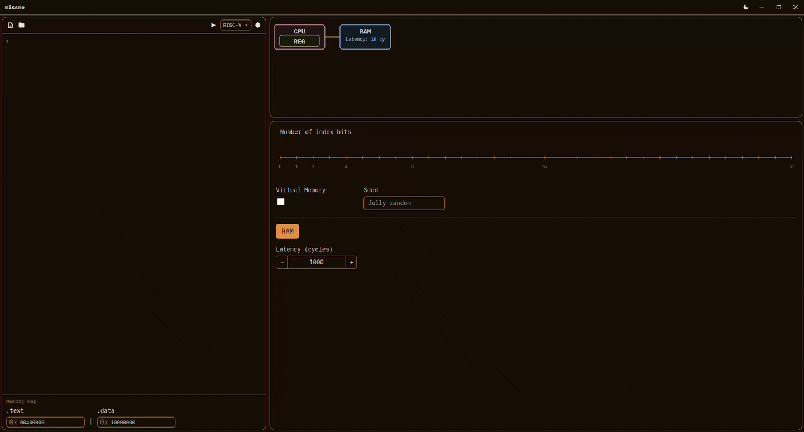

# *missme*

> **M**ISSME **I**s a **S**imulation **S**ystem for **M**emory hi**E**rarchies

A memory hierarchy simulator. Describe a cache hierarchy, optionally with virtual memory, run a program on it, and watch each access step by step. RISC-V is the first supported language; others can be added.



## Features

- Configurable cache levels: number of sets, block size, associativity, and separate or unified instruction and data caches.
- Replacement policies: LRU, FIFO, LFU, and Random.
- Write policies: write-back and write-through, with write-allocate or no-write-allocate.
- Optional virtual memory: TLB, multi-level page table, physical frames, and disk swapping.
- Step through each memory access or each instruction, or run continuously. Breakpoints can be added or removed while the program runs.
- Live views of each level: cache sets, TLB entries, page table, frames, RAM, and disk.
- Statistics per level: hits, misses, hit rate, cycles, AMAT, CPI, and MPKI.

## Installation

### Requirements

- [Node.js](https://nodejs.org/) (LTS)
- [Rust](https://www.rust-lang.org/tools/install) (stable)
- The Tauri system dependencies for your platform. On **Arch Linux**:

  ```bash
  sudo pacman -S --needed webkit2gtk-4.1 base-devel curl wget file openssl appmenu-gtk-module libappindicator-gtk3 librsvg
  ```

  For any other operating system, follow the official [Tauri prerequisites](https://tauri.app/start/prerequisites/) guide.

MISSME is built with [Tauri](https://tauri.app/): a Rust backend and a Vue 3 + TypeScript frontend.

### Build from source

```bash
git clone https://github.com/adriamg101/missme.git
cd missme
npm install
npm run tauri dev      # run the app in development mode
npm run tauri build    # create the installer for your platform
```

### Pre-built packages

Once a release is published, installers for Windows, macOS, and Linux are attached to the [Releases](https://github.com/adriamg101/missme/releases) page. They are not signed, so Windows and macOS may show a warning the first time you open them.

On macOS, double-clicking the app the first time may refuse to open it:

- On most versions, the system says it is from an unidentified developer. Right-click the app and choose **Open** instead of double-clicking, then confirm in the dialog that appears.
- On newer versions (macOS Sequoia and later), the system instead says the app is damaged and can't be opened, without an option to open it anyway. In that case, open a Terminal and run:

  ```bash
  xattr -cr /Applications/missme.app
  ```

  (adjust the path if you placed the app somewhere else), then open it normally.

Either way, this is only needed once per machine; after that the app opens normally.

## Usage

1. Open the editor and write a program in RISC-V assembly.
2. Set the memory map for `.text` and `.data`, and the ISA extensions you want to use.
3. Configure the memory hierarchy: caches, TLB, virtual memory, RAM, and disk.
4. Start the simulation. You can step one memory access at a time, one instruction at a time, or run until a breakpoint.
5. Click the line numbers in the editor to add or remove breakpoints, even while the simulation is running.
6. Use the views to inspect what happens at each level, and the statistics panel to compare configurations.

## Program format

Programs are written in RISC-V assembly. Put code in the `.text` section and data in the `.data` section:

```asm
.data
values: .word 1, 2, 3, 4

.text
.globl main
main:
    la   t0, values
    lw   t1, 0(t0)
    ret
```

## License

MISSME is licensed under the [Apache License 2.0](LICENSE). See [NOTICE](NOTICE) for the copyright notice. If you build another tool on top of MISSME, keep the `NOTICE` file with your distribution, as the license requires.

## Author

Adrià Martínez Gallifa - ([@adriamg101](https://github.com/adriamg101))

## Project structure

```
missme/
├── examples/
│   └── riscv/             Sample RISC-V programs
├── src/                   Frontend (Vue 3 + TypeScript)
│   ├── components/        UI components
│   │   ├── compile-config/     Memory map and compile settings
│   │   ├── hierarchy-config/   Cache, TLB, RAM, and disk configuration
│   │   ├── simulation/         Live views and statistics
│   │   └── ui/                 Shared controls
│   ├── lib/               Hierarchy model, virtual scrolling, and helpers
│   └── stores/            Pinia stores for configuration and simulation state
└── src-tauri/             Backend (Rust, Tauri)
    └── src/
        ├── controllers/   Tauri commands called by the frontend
        └── models/
            ├── interpreter/       Language frontends (lexer, parser, code generation)
            │   └── riscv/         RISC-V implementation
            └── simulation/        CPU simulator, session control, statistics
                └── memory/        Cache, TLB, page table, frames, RAM, disk, replacement policies
```

## Acknowledgments

The memory hierarchy model is based on the concepts described in Hennessy and Patterson's *Computer Organization and Design* and *Computer Architecture: A Quantitative Approach*.
